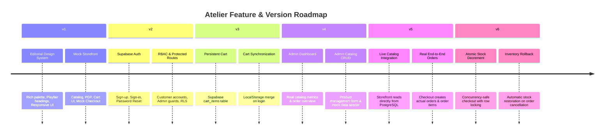

# Milestones & What We Have Achieved

This document tracks the journey of Atelier from an initial static design prototype to an end-to-end e-commerce platform with live database operations, role-based security, server cart synchronization, and atomic inventory management.

---

## 1. Evolution Timeline & Milestones

---

## 2. Version Breakdown

### Version 6 — Atomic Inventory & Stock Validation (Current)
* **Goal**: Prevent inventory overselling and race conditions when multiple shoppers check out concurrently.
* **Key Achievements**:
  * **Database-level concurrency safety**: Implemented PostgreSQL function `check_and_decrement_stock` utilizing `SELECT ... FOR UPDATE` locks ordered by product IDs to eliminate deadlocks.
  * **Atomic multi-step checkout**: Built stored procedure `place_order` that verifies stock, decrements quantities, inserts order and line item records, and empties the cart within a single database transaction.
  * **Intelligent shortage reporting**: If one or more requested items exceed stock, the order is cancelled before row insertion, returning descriptive payloads indicating exact requested vs. available quantities.
  * **Auto-restoration trigger**: Added trigger `trg_restore_stock_on_cancel` on `public.orders` that replenishes product stock when order status transitions to `cancelled`.
  * **Live stock visibility**: Admin catalog view immediately reflects stock movements without manual sync.

### Version 5 — Full Storefront Connection to Live Database
* **Goal**: Deprecate static mock catalog in favor of PostgreSQL live data.
* **Key Achievements**:
  * **Connected catalog**: Storefront views (`/`, `/shop`, `/shop/:category`, `/product/:slug`) read directly from Supabase via TanStack Query.
  * **Real order placement**: Checkout workflow writes authenticated customer orders into `orders` and `order_items` tables.
  * **Live search autocomplete**: Global header search queries PostgreSQL in real time.
  * **Real order history**: Customer account views `/orders` and `/orders/:id` display real orders and support user-initiated cancellation for pending orders.
  * **Data mapping layer**: Built `products-db.ts` to bridge JSONB database fields into typed frontend interfaces.

### Version 4 — Admin Management Dashboard & Catalog Operations
* **Goal**: Empower administrators to manage catalog, orders, and review store performance.
* **Key Achievements**:
  * **Admin metrics dashboard**: Real-time revenue, order counts, and catalog volume.
  * **Product CRUD operations**: Complete product creation/editing modal with image arrays, size/color selectors, and tags.
  * **Demo catalog importer**: One-click ingestion utility to seed mock data into Supabase `products`.
  * **Order management suite**: Order filtering by fulfillment status (`pending`, `processing`, `shipped`, `delivered`, `cancelled`) with detail inspectors.

### Version 3 — Server-Backed Cart & Guest Merge
* **Goal**: Provide cross-device cart persistence for authenticated customers without hurting guest user experience.
* **Key Achievements**:
  * **Hybrid storage strategy**: LocalStorage for anonymous guests; Supabase `cart_items` for authenticated customers.
  * **Seamless merge on login**: Transparently transfers local items to remote database upon sign-in.
  * **Duplicate prevention**: Database unique constraint on `(user_id, product_id, size, color)` enforces clean quantity updates instead of row duplication.

### Version 2 — Authentication & Role-Based Access Control (RBAC)
* **Goal**: Secure customer account pages and administrative endpoints.
* **Key Achievements**:
  * **Supabase Auth**: Fully wired email/password sign-up, sign-in, and password reset flows.
  * **RBAC with RLS**: `user_roles` mapping users to `customer` and `admin` roles, secured by PostgreSQL Row Level Security.
  * **Layout route guards**: TanStack Start `beforeLoad` interceptors for customer account and admin portal routes.
  * **Profile synchronization**: Auto-creation trigger creating profile rows on auth user signup.

### Version 1 — Editorial Storefront Design & UI System
* **Goal**: Create a luxury, editorial fashion brand experience.
* **Key Achievements**:
  * **Visual aesthetic**: Custom typography pairing (`Playfair Display` + `Inter`) and warm luxury color palette.
  * **Rich interactive UI**: Hover animations, animated cart flyout, responsive product filters, photo galleries, and rating breakdowns.
  * **Responsive layouts**: Optimized for desktop, tablet, and mobile screens using Tailwind CSS v4 and shadcn/ui.

---

## 3. Current Feature Maturity Matrix

| Capability | Status | Implementation Details |
|---|---|---|
| **Editorial Landing & Shop UI** |  Completed | Responsive grid, multi-attribute filtering, sorting |
| **Product Detail Experience** |  Completed | Variant selector, size guide, image carousel, review summary |
| **User Authentication & Profiles** |  Completed | Supabase GoTrue Auth, profile management, password recovery |
| **Cross-Device Cart** |  Completed | Hybrid LocalStorage + Supabase sync with guest merge |
| **Admin Operations** |  Completed | Product CRUD, order status progression, live analytics |
| **Atomic Inventory Control** |  Completed | Row-level locking, atomic checkout RPC, cancellation rollback |
| **Payment Gateway** |  Next Step | Stripe / Razorpay checkout integration |
| **Transactional Notifications** |  Next Step | Order confirmation and shipping update emails |
| **Live Shipping Tracking** |  Next Step | Courier API integration (Shiprocket / EasyPost) |
