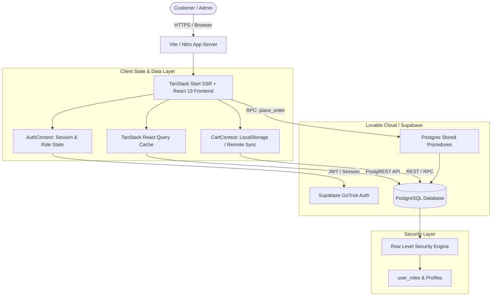
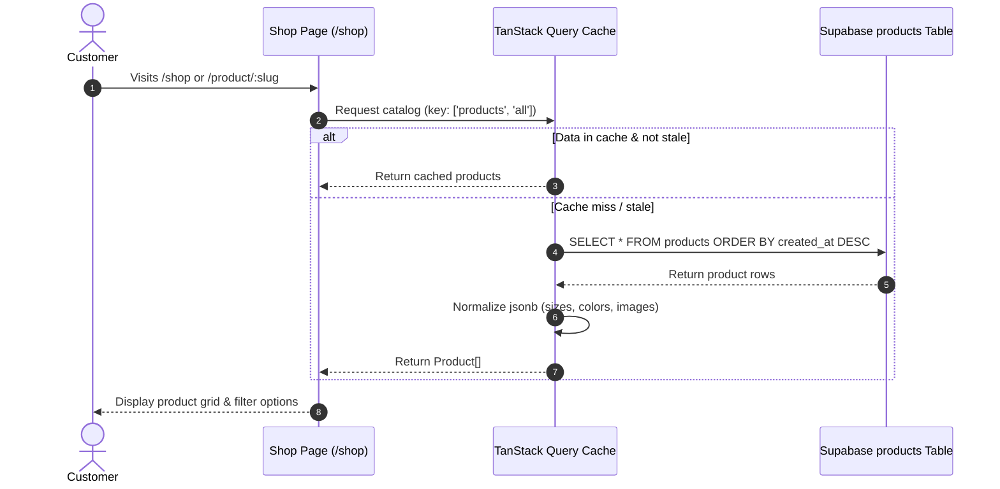
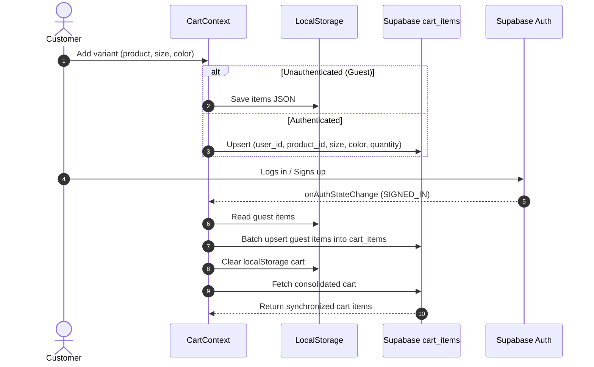
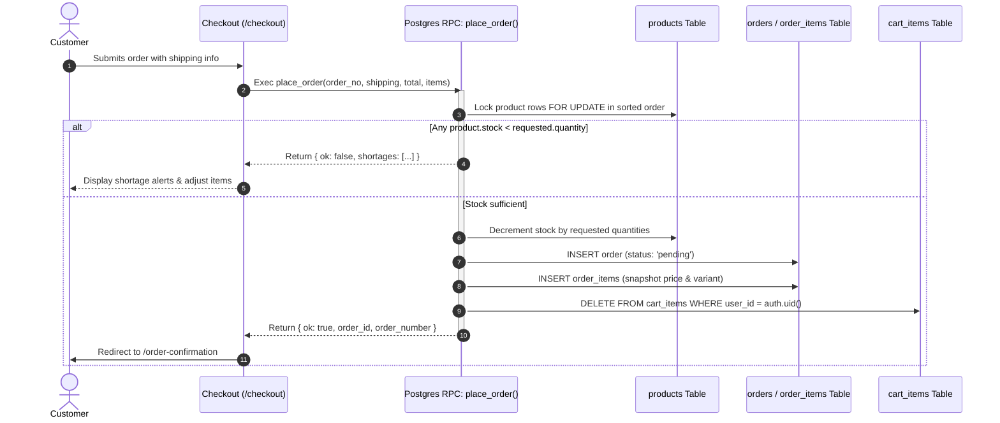

# High-Level Design (HLD) — Atelier Storefront

## 1. System Overview

**Atelier** is a modern, high-performance, editorial fashion e-commerce web application. The platform provides a seamless shopping journey for customers—from catalog browsing and dynamic filtering to resilient cart management and atomic checkout—alongside an administrative dashboard for inventory, catalog management, and order lifecycle tracking.

---

## 2. Key Architecture Principles

1. **Full-Stack SSR & Client Hydration**:
   - Built on **TanStack Start** with Vite and Nitro runtime.
   - Initial renders benefit from server-rendered HTML for fast First Contentful Paint (FCP) and SEO, hydrating into an interactive single-page application (SPA).

2. **Decoupled Architecture with Managed BaaS**:
   - Data persistence, relational storage, and authentication are managed via Supabase (PostgreSQL).
   - Database operations enforce strict **Row Level Security (RLS)**, ensuring data isolation between tenants, customers, and administrators.

3. **Atomic Consistency in E-Commerce Workflows**:
   - Checkout is transactional: inventory checking, stock decrementing, order item creation, and cart evacuation occur inside an ACID PostgreSQL transaction.
   - Over-selling and race conditions under concurrent checkouts are strictly prevented via `SELECT ... FOR UPDATE` row locks.

4. **Progressive Resilience**:
   - Guests can curate carts and browse without authentication (using local persistence).
   - Upon authentication, cart contents transparently merge into server-side storage without loss of user selections.

---

## 3. System Architecture & Tiers

### 3.1 Presentation & Application Tier (TanStack Start + React 19)
- **File-based Routing**: Routes map cleanly to filesystem files under `src/routes/` with path-based and layout nesting (`_admin`, `_authenticated`).
- **Styling & Design System**: Tailwind CSS v4 coupled with shadcn/ui accessible components, styled with an editorial palette (warm cream `#FAF8F5`, espresso `#1A1918`, terracotta `#C46849`).
- **Client Cache**: TanStack Query (`@tanstack/react-query`) manages network caching, stale-while-revalidate invalidation, and optimistic state.

### 3.2 Authentication & Authorization Tier
- **Authentication**: Managed through Supabase Auth (JWT bearer tokens stored in browser cookies / local storage).
- **Role-Based Access Control (RBAC)**:
  - Roles (`customer`, `admin`) are stored in `public.user_roles`.
  - Database functions (`has_role(_user_id, _role)`) protect sensitive database operations.
  - Route guards (`_admin.tsx` and `_authenticated.tsx`) evaluate authentication state on route transition and redirect unpermitted users.

### 3.3 Data & Persistence Tier (PostgreSQL)
- Relational schema for `profiles`, `user_roles`, `products`, `cart_items`, `orders`, and `order_items`.
- JSONB columns provide flexibility for variants (sizes, hex colors, image arrays, metadata tags) while maintaining strong relational integrity for transactional entities.

---

## 4. End-to-End Data & Transaction Flows

### 4.1 Browsing & Catalog Pipeline

### 4.2 Cart Synchronization Flow (Guest to Authenticated)

### 4.3 Atomic Checkout & Inventory Reservation Flow

---

## 5. Security & Isolation Architecture

- **Row Level Security (RLS)**:
  - `products`: Publicly readable (`SELECT true`), writable only by users with the `'admin'` role.
  - `orders`: Users can only `SELECT` and `INSERT` orders matching their own `user_id`; admins can read/update all orders.
  - `order_items`: Accessible only if linked to an order owned by `auth.uid()` or by an admin.
  - `cart_items`: Strictly isolated where `user_id = auth.uid()`.
- **Security Definer Procedures**:
  - `place_order()` and `check_and_decrement_stock()` run as `SECURITY DEFINER` with fixed `search_path = public` to guarantee non-circumventable atomic stock operations.

---

## 6. Scalability & Extensibility Roadmap

1. **Payment Gateway Integration**:
   - Webhook-driven payment architecture (Stripe / Razorpay).
   - Intermediate order states (`awaiting_payment` -> `processing` / `cancelled`).
2. **Dedicated API Server (Optional)**:
   - Capable of moving beyond BaaS to an Express / Fastify / Go microservice backend if custom complex business workflows require it.
3. **Event-driven Email & Notifications**:
   - Supabase Database Webhooks or Edge Functions emitting order event payloads to transactional mailing services (Resend / SendGrid).
