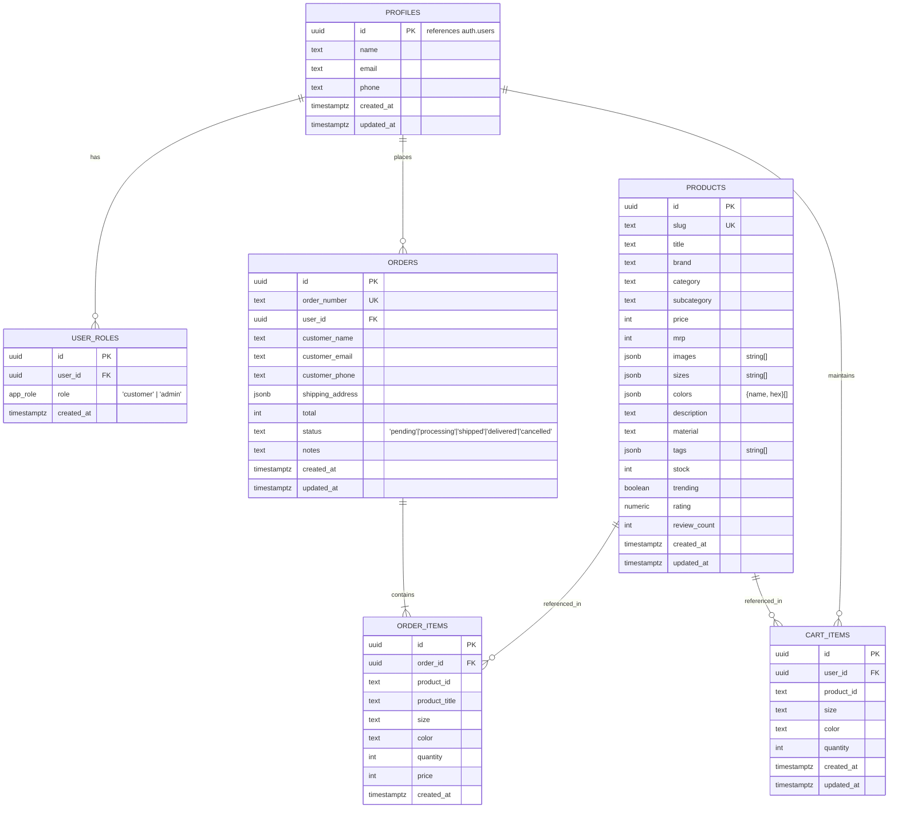

# Low-Level Design (LLD) — Atelier Storefront

## 1. Directory & Module Breakdown

The codebase follows a modular structure separated into layout shells, page controllers, reusable presentation components, centralized business state, and data access layers:

```text
stylehorizon/
├── src/
│   ├── components/            # UI components and atomic design building blocks
│   │   ├── admin/             # Admin-specific components (ProductForm, stats)
│   │   ├── ui/                # shadcn/ui primitives (Radix UI wrappers)
│   │   ├── ProductCard.tsx    # Responsive product card with hover animations
│   │   ├── SiteHeader.tsx     # Navigation, search modal, cart drawer trigger, auth menu
│   │   └── SiteFooter.tsx     # Footer links, newsletter subscription, branding
│   ├── integrations/
│   │   └── supabase/          # Supabase client instantiation, SSR middleware, and types
│   │       ├── client.ts          # Browser Supabase client
│   │       ├── client.server.ts   # Server-side Supabase client for SSR
│   │       ├── auth-middleware.ts # SSR route authentication interceptor
│   │       └── types.ts           # Generated / extended TypeScript database schema types
│   ├── lib/                   # Utility helpers and domain services
│   │   ├── admin-products.ts  # Admin mutations (seed, upsert, delete products)
│   │   ├── products-db.ts     # Storefront catalog query hooks and mapping layer
│   │   ├── format.ts          # Currency and regional formatters (INR)
│   │   ├── image-fallback.ts  # Graceful placeholder image generators
│   │   ├── error-capture.ts   # Error telemetry and capture wrapper
│   │   ├── lovable-error-reporting.ts # Telemetry dispatcher
│   │   └── utils.ts           # Tailwind className merger (clsx + twMerge)
│   ├── routes/                # TanStack Start file-based routing
│   │   ├── __root.tsx         # Root layout shell with query provider, toasts, header/footer
│   │   ├── _admin.tsx         # Admin layout with authentication and role guard
│   │   ├── _authenticated.tsx # Customer layout with login requirement guard
│   │   ├── index.tsx          # Storefront landing page
│   │   ├── shop.index.tsx     # Catalog landing
│   │   ├── shop.$category.tsx # Category catalog with multi-facet filters
│   │   ├── product.$slug.tsx  # Product detail page (gallery, variants, reviews)
│   │   ├── cart.tsx           # Cart view & price breakdown
│   │   ├── checkout.tsx       # Checkout wizard (shipping, address, atomic order RPC)
│   │   └── order-confirmation.tsx # Order success page
│   ├── store/                 # Global state providers
│   │   ├── auth.tsx           # AuthContext (user, session, role, loading)
│   │   └── cart.tsx           # CartContext (items, sync, subtotal, discount, tax)
│   └── styles.css             # Tailwind CSS tokens, theme variables, and global animations
└── supabase/
    └── migrations/            # Version-controlled SQL migrations
```

---

## 2. Route Hierarchy & Route Guards

TanStack Start implements file-based routing. Special prefix conventions define layout behavior:

```mermaid
graph TD
    Root["__root.tsx (Root Layout Shell)"]
    
    Root --> PublicRoutes["Public Routes"]
    PublicRoutes --> Home["/ (index.tsx)"]
    PublicRoutes --> Shop["/shop (shop.index.tsx)"]
    PublicRoutes --> ShopCat["/shop/:category (shop.$category.tsx)"]
    PublicRoutes --> PDP["/product/:slug (product.$slug.tsx)"]
    PublicRoutes --> CartPage["/cart (cart.tsx)"]
    PublicRoutes --> Login["/login, /signup, /forgot-password"]
    
    Root --> AuthGuard["_authenticated.tsx (Customer Guard)"]
    AuthGuard --> Account["/account (_authenticated.account.tsx)"]
    AuthGuard --> Orders["/orders (_authenticated.orders.index.tsx)"]
    AuthGuard --> OrderDetail["/orders/:id (_authenticated.orders.$id.tsx)"]
    AuthGuard --> Checkout["/checkout (checkout.tsx)"]
    
    Root --> AdminGuard["_admin.tsx (Admin Role Guard)"]
    AdminGuard --> AdminDash["/admin (_admin.admin.index.tsx)"]
    AdminGuard --> AdminProducts["/admin/products (_admin.admin.products.index.tsx)"]
    AdminGuard --> AdminProductNew["/admin/products/new (_admin.admin.products.new.tsx)"]
    AdminGuard --> AdminProductEdit["/admin/products/:id (_admin.admin.products.$id.tsx)"]
    AdminGuard --> AdminOrders["/admin/orders (_admin.admin.orders.index.tsx)"]
    AdminGuard --> AdminOrderDetail["/admin/orders/:id (_admin.admin.orders.$id.tsx)"]
```



### Route Guard Implementations:
1. **Customer Guard (`_authenticated.tsx`)**:
   ```typescript
   export const Route = createFileRoute('/_authenticated')({
     beforeLoad: async ({ context, location }) => {
       const user = await context.auth.getUser();
       if (!user) {
         throw redirect({ to: '/login', search: { redirect: location.href } });
       }
     },
     component: () => <Outlet />
   });
   ```
2. **Admin Guard (`_admin.tsx`)**:
   ```typescript
   export const Route = createFileRoute('/_admin')({
     beforeLoad: async ({ context }) => {
       const user = await context.auth.getUser();
       const isAdmin = await context.auth.hasRole('admin');
       if (!user || !isAdmin) {
         throw redirect({ to: '/admin/login' });
       }
     },
     component: AdminLayout
   });
   ```

---

## 3. Database Schema & Data Models

### 3.1 Entity Relationship Diagram (ERD)



---

## 4. PostgreSQL Stored Procedures & Triggers

### 4.1 Stock Check & Decrement Function (`check_and_decrement_stock`)
- **Signature**: `check_and_decrement_stock(items jsonb) RETURNS jsonb`
- **Concurrency Strategy**: Aggregates requested quantities in a temporary table, locks rows using `SELECT ... FOR UPDATE ORDER BY p.id` to prevent deadlocks, evaluates if available stock covers requests, and either decrements or returns descriptive shortage objects.

### 4.2 Atomic Checkout Transaction (`place_order`)
- **Signature**: `place_order(p_order_number text, p_customer_name text, p_customer_email text, p_customer_phone text, p_shipping_address jsonb, p_total numeric, p_items jsonb) RETURNS jsonb`
- **Transaction Steps**:
  1. Validates caller authentication via `auth.uid()`.
  2. Executes `check_and_decrement_stock(...)`. If any item falls short, rolls back and returns `{ ok: false, shortages: [...] }`.
  3. Inserts into `public.orders`.
  4. Loops and inserts rows into `public.order_items`.
  5. Clears `public.cart_items` for the current user.
  6. Returns `{ ok: true, order_id, order_number }`.

### 4.3 Automatic Stock Restoration Trigger (`restore_stock_on_cancel`)
- Runs `AFTER UPDATE OF status ON public.orders`.
- If `NEW.status = 'cancelled'` and `OLD.status <> 'cancelled'`:
  ```sql
  UPDATE public.products p
  SET stock = p.stock + oi.quantity
  FROM public.order_items oi
  WHERE oi.order_id = NEW.id AND oi.product_id = p.id;
  ```

---

## 5. State Management & Data Access Layer

### 5.1 `AuthContext` (`src/store/auth.tsx`)
- Maintains session state using `supabase.auth.onAuthStateChange`.
- Exposes:
  - `user`: Supabase user object or `null`.
  - `role`: Role string (`'customer'`, `'admin'`, or `null`).
  - `loading`: Boolean indicating auth initialization.
  - `signOut()`: Terminates session and triggers cart teardown.

### 5.2 `CartContext` (`src/store/cart.tsx`)
- **Hybrid Storage**:
  - Unauthenticated visitors store items in `localStorage['atelier_cart']`.
  - Authenticated visitors store items in Supabase table `cart_items`.
- **Merge Lifecycle**:
  - When `user` changes from `null` to authenticated, `CartContext` reads local items and fires batch upserts to Supabase, then clears `localStorage`.
- **Calculated Properties**:
  - `itemsCount`: Sum of all item quantities.
  - `subtotal`: `sum(item.product.price * item.quantity)`.
  - `discount`: Pre-calculated savings against MRP.
  - `shipping`: Free threshold logic or fixed shipping cost.
  - `total`: `subtotal + shipping`.

### 5.3 Product Data Layer (`src/lib/products-db.ts`)
- Bridges raw database schema with UI component types:
  - `mapProductRow(row: ProductRow): Product`: Deserializes JSONB array attributes (tags, sizes, color objects with `{ name, hex }`, image URLs).
  - `useProducts()`: TanStack Query hook with 30s stale time caching catalog.
  - `useProduct(slug: string)`: TanStack Query hook caching individual product detail pages.
